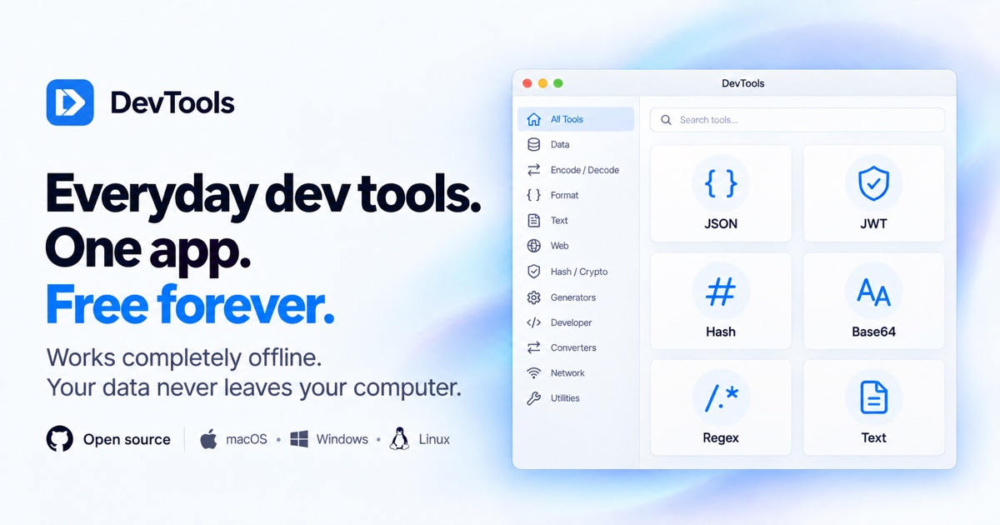
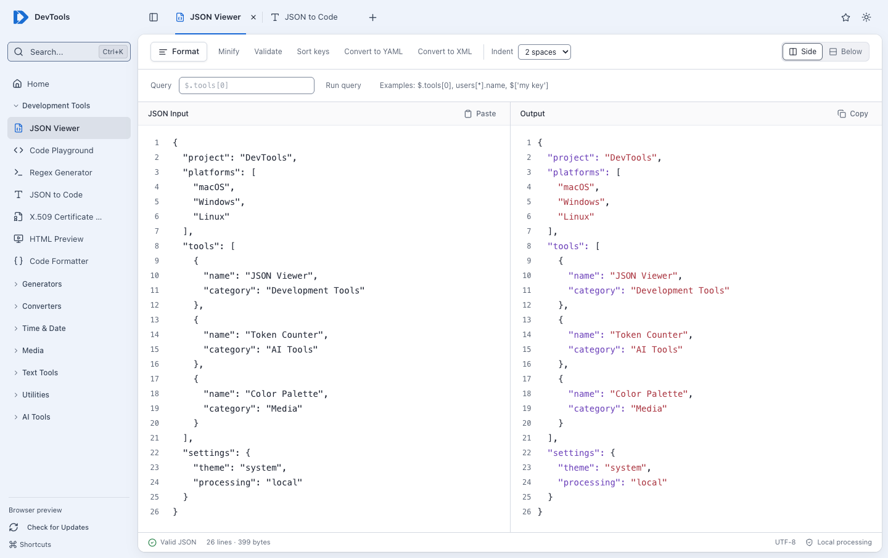
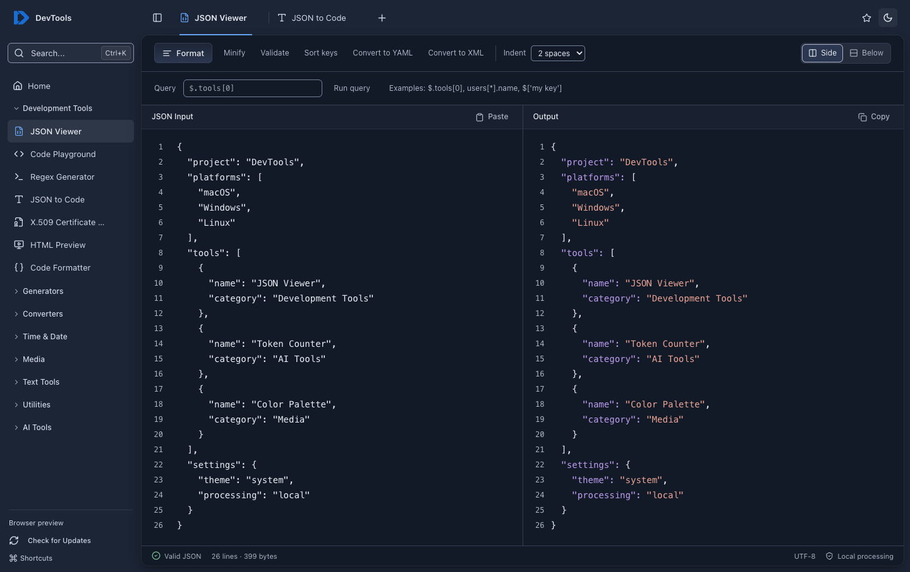

# Shard

A desktop workspace with 54 built-in developer utilities, and plugins for more, for macOS, Windows, and Linux. Format JSON, inspect tokens and certificates, convert data, generate code, and prepare text and images for AI workflows with local processing.



[Download](#download) · [Plugins](#plugins) · [Tools](#tools) · [Workspace and shortcuts](#workspace-and-shortcuts) · [Development](#development) · [Support](#support)




<details>
<summary>See dark mode</summary>



</details>

Screenshots show the current web UI in browser preview. The installed desktop app adds native window integration, tray access, global shortcuts, deep links, and automatic updates.

The utilities work offline without an account or an AI API key. Shard includes no analytics or telemetry. The AI tools process your content locally; they do not call an AI service. App updates use the network.

## Download

Get the latest release for your platform:

- **[macOS (Intel)](https://github.com/kinan9011/shard/releases/latest/download/Shard-macos-x64.dmg)**
- **[macOS (Apple Silicon)](https://github.com/kinan9011/shard/releases/latest/download/Shard-macos-arm64.dmg)**
- **[Windows](https://github.com/kinan9011/shard/releases/latest/download/Shard-windows-setup.exe)**
- **[Linux — .deb (Debian, Ubuntu, Mint) (x64)](https://github.com/kinan9011/shard/releases/latest/download/Shard-linux-amd64.deb)**
- **[Linux — .deb (Debian, Ubuntu, Mint) (arm64)](https://github.com/kinan9011/shard/releases/latest/download/Shard-linux-arm64.deb)**
- **[Linux — .rpm (Fedora, RHEL, openSUSE) (x64)](https://github.com/kinan9011/shard/releases/latest/download/Shard-linux-x86_64.rpm)**
- **[Linux — .rpm (Fedora, RHEL, openSUSE) (arm64)](https://github.com/kinan9011/shard/releases/latest/download/Shard-linux-aarch64.rpm)**
- **[Linux — .AppImage (x64)](https://github.com/kinan9011/shard/releases/latest/download/Shard-linux-x86_64.AppImage)**
- **[Linux — .AppImage (arm64)](https://github.com/kinan9011/shard/releases/latest/download/Shard-linux-arm64.AppImage)**

### Automatic updates

Shard checks for updates on startup and every six hours, downloads new versions in the background, and installs them when you quit. Use **Restart now** to install a downloaded update immediately, or turn off **Update automatically** in the sidebar to manage updates yourself. Update checks and downloads require an internet connection.

## Plugins

Shard 3 adds plugins: tools you install, each with a web interface and an optional WebAssembly backend. Open **Plugins** in the app.

- **Install from a repository, a zip file, a folder, or a GitHub URL.** The official repository, [`kinan9011/shard-plugins`](https://github.com/kinan9011/shard-plugins), is added for you and can be turned off. You can add your own. Packages from a repository are checked against a SHA-256 checksum. A zip, folder, or URL outside your repositories is unverified and needs the setting **Allow installs from zip files, folders and URLs outside these repositories**.
- **You approve what a plugin can do.** A plugin lists its permissions (clipboard, files, network access to named hosts) before it installs. Optional permissions can be left off, and you can change them later.
- **Plugins run in a sandbox.** A plugin's page runs in a sandboxed frame with no access to the app, and reaches the clipboard, files, and network only through the host, which checks every call against your approvals. A plugin that stops responding shows **Reload** and **Disable** and does not affect the rest of the app. See [plugin security](docs/plugins/security.md) for the model, the checks, and the known limits.
- **Nine tools are built in and always there:** JSON Viewer, Code Playground, Regex Tester, JSON to Code, JSON Schema Validator, JSON Diff, Text Compare, Diff & Merge, and JWT Decoder. You can hide them, but not uninstall them.
- **First run.** A new install opens a short setup: pick a layout (Sidebar or Launcher), install starter plugins, and pin tools to Home. Upgrading from 2.x shows a one-time note instead.
- **Write your own.** Start from the template in [`packages/plugin-sdk/`](packages/plugin-sdk/README.md). The docs cover the [manifest](docs/plugins/manifest.md), [permissions](docs/plugins/permissions.md), and the [repository index](docs/plugins/index-format.md). The sources of the official plugins are in [`kinan9011/shard-plugins`](https://github.com/kinan9011/shard-plugins), and `plugins/examples/hello` is the smallest working plugin.

## Workspace and shortcuts

- **Keep tools open in tabs.** Switch between tools without losing their current inputs. Close a tab when you are finished.
- **Search by name or keyword.** Open the command palette with Cmd+K on macOS or Ctrl+K on Windows and Linux. Search for terms such as `sha`, `yml`, or `diff`.
- **Pinned tools and recents.** Pin up to 12 tools to Home, reorder them, and return to recently used tools. Cmd/Ctrl+1 through 5 opens your first five pinned tools. Customize these bindings in **Shortcuts**.
- **Light and dark appearance.** Shard follows the system theme initially; use the appearance button to switch between light and dark.

- **Paste to find a tool.** Paste text outside a text field, and Shard suggests the tool that fits: a JWT, JSON, a URL, a UUID, a timestamp, a cron expression, a certificate, a cURL command, and more. Press Enter to open the tool with the text filled in. Shard only reads what you paste. It never reads the clipboard on its own.
- **Menu bar and tray.** The Shard icon in the macOS menu bar, or the Windows and Linux tray, opens the app or its tool search.
- **Global shortcut.** Press Ctrl+Shift+Space in any app to open Shard with its tool search. Press it again to hide Shard. Change or turn off the shortcut in Shortcuts.

### Open a tool from other apps

Shard registers the `shard://` link scheme, so Raycast, Alfred, Shortcuts, a terminal, or a browser can open a tool directly. A link reuses the running window.

| Link | Result |
|---|---|
| `shard://open/<tool-id>` | Opens a tool, for example `shard://open/json-viewer`. The tool IDs are in [the tool registry](src/app/toolRegistry.ts). |
| `shard://search?q=<text>` | Opens the command palette with the text. |
| `shard://home` | Shows the home page. |

From a terminal on macOS, run `open "shard://open/hash-generator"`. On Linux, run `xdg-open` with the same link. On Windows, run `start` with the link.

## Tools

### Development Tools

- **JSON Viewer** - Format, minify, sort, and query JSON live, convert it to YAML or XML, and repair JSON5, NDJSON, and Python, Ruby, or JavaScript literals
- **Code Playground** - Experiment with JavaScript, HTML, and CSS
- **Regex Tester** - Test a pattern as you type, with highlighted matches, capture groups, and live replace
- **JSON to Code** - Generate TypeScript, Go, Rust, Python, Swift, and Kotlin types, or a JSON Schema, from JSON
- **JSON Schema Validator** - Check JSON or YAML against a JSON Schema as you type, and click each error to find the failing value
- **JSON Diff** - Compare two JSON or YAML documents by value, list changes by path, match array items by key, and copy the changes as a JSON Patch

### Generators


The **Hash Generator** (MD5, SHA-1, SHA-2, SHA-3, Keccak-256, HMAC and file hashing), the **UUID Generator** (UUIDs v1 to v7, ULIDs, and an inspector), the **Cron Calculator** (plain-English explanations, a field breakdown, the next runs, and a visual builder), **Markdown** (live, sanitized preview and HTML export), the **Color Palette** (color conversion, palettes, WCAG contrast, color blindness, and CSS gradients), the **Unit Converter**, the **chmod Calculator**, **Checksum** (CRC variants and Luhn check digits), the **IP / CIDR Calculator**, the **HAR Viewer**, **Timestamp**, **Date Difference**, the **Date Format Translator**, the **Stopwatch**, the **Time Zone Converter**, **API Formatter**, **String Inspector**, **Line Tools**, the **Password Generator**, **Lorem Ipsum**, the **QR Generator**, the **Bcrypt Generator**, **Random String**, and the **Key Pair Generator**, **Base64**, the **Case Converter**, **Number Base**, the **URL Encoder**, **CSV to JSON**, the **Config Converter**, **Escape Tools**, **HTML to JSX**, **SVG to CSS**, **PHP Tools**, **Compression**, **cURL to Code**, the **X.509 Certificate Decoder**, **HTML Preview**, the **Code Formatter**, the **Semver Calculator**, the **XML Inspector**, the **ASN.1 Inspector**, and the **Mermaid Renderer** are plugins now. Install them from Plugins in the app. Their sources are in [`kinan9011/shard-plugins`](https://github.com/kinan9011/shard-plugins).

### Converters


### Media

- **Image Converter** - Convert and compress single images or batches locally to JPEG (MozJPEG), PNG (OxiPNG), WebP, or AVIF. Resize with Lanczos3 and other filters, and reduce the color palette. Crop, rotate, and flip an image in the Edit Image tab
- **QR Reader** - Read a QR code from an image file, a dropped image, or a pasted screenshot

### Text Tools

- **Text Compare** - Aligned line, word and character diff with change navigation that can ignore whitespace and case
- **Diff & Merge** - JetBrains-style side-by-side diff with one-click merge arrows, word highlights, unified view and folder compare (desktop)
- **JWT Decoder** - Decode JWTs with expiry status, verify HS, RS, PS, ES, and EdDSA signatures with a secret, PEM, JWK, or JWKS, and sign test tokens

### AI Tools

- **Image Metadata Cleaner** - Remove AI prompts, Content Credentials (C2PA), AI-generated labels, GPS, and camera data from JPEG, PNG, and WebP images. Keep the original pixels, or save a clean copy as JPG, PNG, WebP, or AVIF
- **Video Metadata Cleaner** - Remove AI labels (C2PA, XMP), GPS, device data, dates, and telemetry tracks from MP4, MOV, MKV, and WebM videos without re-encoding. The audio and video data do not change
- **Secret & PII Redactor** - Mask API keys, tokens, passwords, emails, and other personal data before you paste text into an AI chat, and restore the values in the reply
- **Token Counter** - Count GPT tokens exactly, estimate Claude, Gemini, and Llama tokens, check the context window, and estimate cost from your own price table
- **AI Text Cleaner** - Remove hidden characters, citation markers, and Markdown from AI-written text, and straighten quotes and dashes

### Utilities


## Development

### Prerequisites

- Node.js 22+ and npm.
- Stable Rust, installed with [rustup](https://rustup.rs).
- The [Tauri system prerequisites](https://v2.tauri.app/start/prerequisites/) for your platform.

On Debian or Ubuntu, install the native build dependencies:

```bash
sudo apt-get install -y libwebkit2gtk-4.1-dev libayatana-appindicator3-dev librsvg2-dev \
  libxdo-dev libssl-dev patchelf file rpm
```

### Run locally

```bash
git clone https://github.com/kinan9011/shard.git
cd shard
npm ci
npm run dev
```

For UI-only development, run `npm run dev:web` and open the URL printed by Vite. Browser preview does not provide native desktop integrations or the updater.

### Commands

| Command | Purpose |
|---|---|
| `npm run dev` | Start Vite and the Tauri desktop app with hot reload |
| `npm run dev:web` | Run the web UI in a browser |
| `npm run build:web` | Build the frontend into `dist/` |
| `npm run build` | Build the desktop app and installers for the current platform |
| `npm test` | Run the Vitest suite |
| `npm run test:watch` | Run tests in watch mode |
| `npm run lint` | Run ESLint |
| `npm run dist:mac` | Build macOS `.app` and `.dmg` packages |
| `npm run dist:win` | Build the Windows NSIS installer |
| `npm run dist:linux` | Build Linux AppImage, Debian, and RPM packages |
| `npm run brand:build` | Rebuild logos, favicons, and desktop icons |

Installers are written to `src-tauri/target/release/bundle/`. Each platform builds its own installers; CI builds the supported platforms. See the [release process](docs/release-process.md) for versioning, signing, and publishing.

### Desktop smoke test

The [smoke test](e2e/smoke.mjs) launches the built app through `tauri-driver` and checks the main flows on Linux: it skips the first-run setup, opens the tools, installs the hello plugin from a folder, opens it, and uninstalls it. In addition to the build dependencies, install `xvfb` and `webkit2gtk-driver`:

```bash
sudo apt-get install -y xvfb webkit2gtk-driver
cargo install tauri-driver --locked
npm run build
xvfb-run node e2e/smoke.mjs
```

### Project structure

```text
src/
├── app/
│   ├── Shard.tsx     # Workspace, tabs, navigation, and app settings
│   └── toolRegistry.ts    # Tool names, categories, keywords, and lazy imports
├── components/
│   ├── app/               # Command palette, paste suggestions, and shortcuts
│   └── tools/             # Tool interfaces and shared workspace components
├── lib/desktop.ts         # Bridge to native desktop capabilities
├── utils/                 # Conversion, parsing, generation, and validation logic
└── main.tsx               # React entry point
src-tauri/                 # Rust backend, native integration, and bundle config
tests/                     # Unit and component tests
e2e/                       # Desktop smoke tests
scripts/                   # Release and brand asset tooling
```

Built with Tauri 2, React 18, TypeScript, Vite, Tailwind CSS, and shadcn/ui. Tauri uses the system webview with a Rust backend.

### Add a tool

1. Create the interface in `src/components/tools/YourTool.tsx` and put reusable logic in `src/utils/`.
2. Add its name, unique ID, category, icon, and search keywords to `ALL_TOOLS` in [toolRegistry.ts](src/app/toolRegistry.ts).
3. Register its lazy-loaded component in `TOOL_COMPONENTS` in the same file. The registry supplies sidebar navigation and tool search.
4. Add tests for non-trivial behavior, run the relevant checks, and update the tool list in this README.

## Contributing

Pull requests are welcome. For major changes, open an issue first to discuss the proposal. Include a description of the change and the checks you ran; include current screenshots for UI changes.

## Support

Shard is free and open source. Found a bug or have an idea? [Open an issue](https://github.com/kinan9011/shard/issues).

## Brand assets

The [brand asset guide](assets/brand/README.md) includes SVG and PNG logos, desktop icons, social artwork, colors, and usage rules. The approved brand name is **Shard**.

## License

MIT. See [LICENSE](LICENSE). Shard is based on [DevTools](https://github.com/me-shaon/devtools) by Ahmed Shamim.
