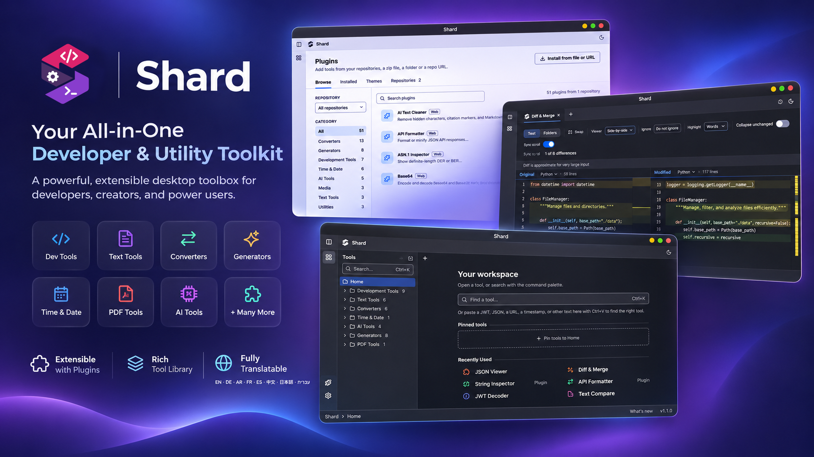
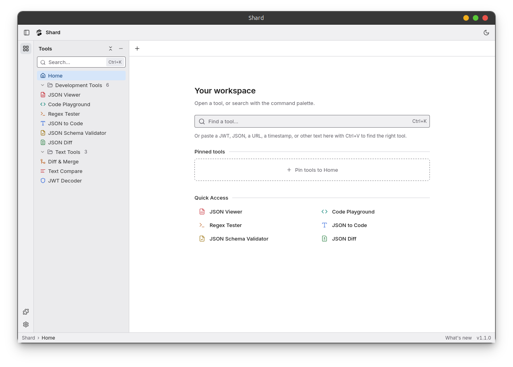
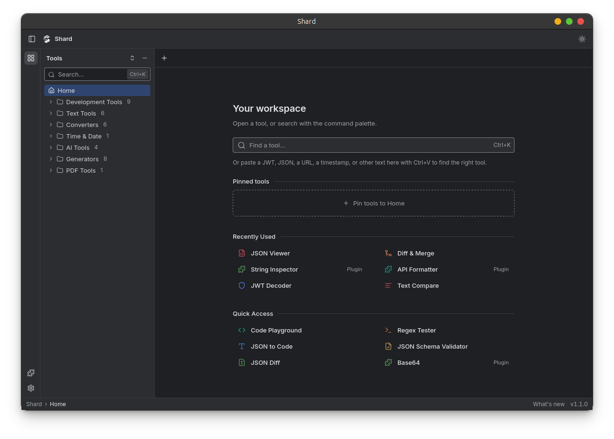
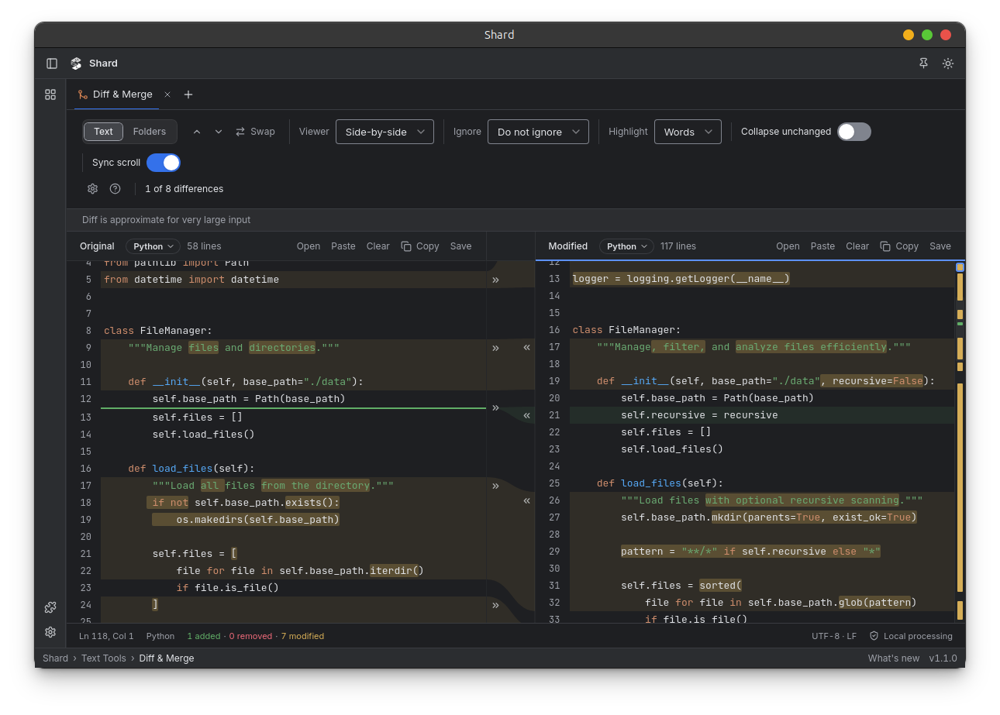
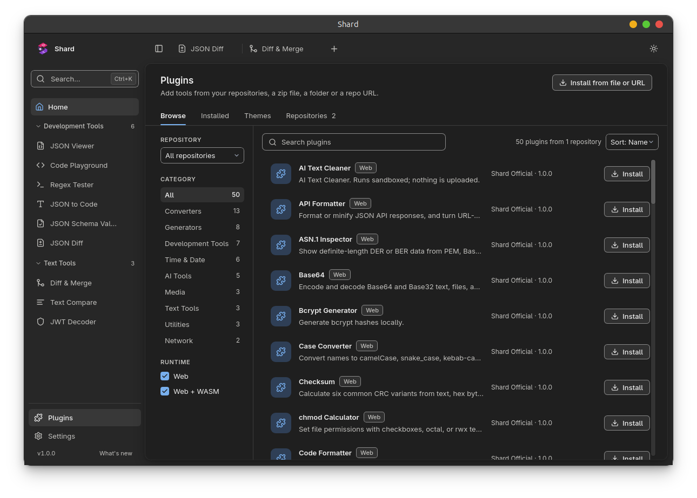
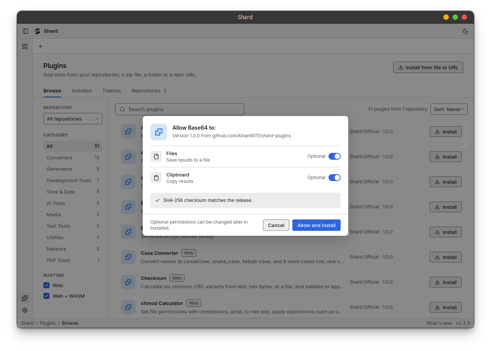
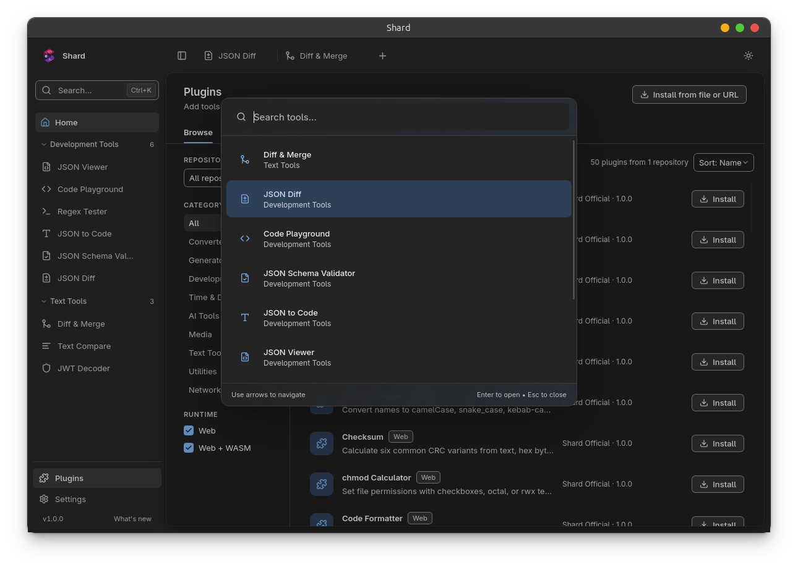
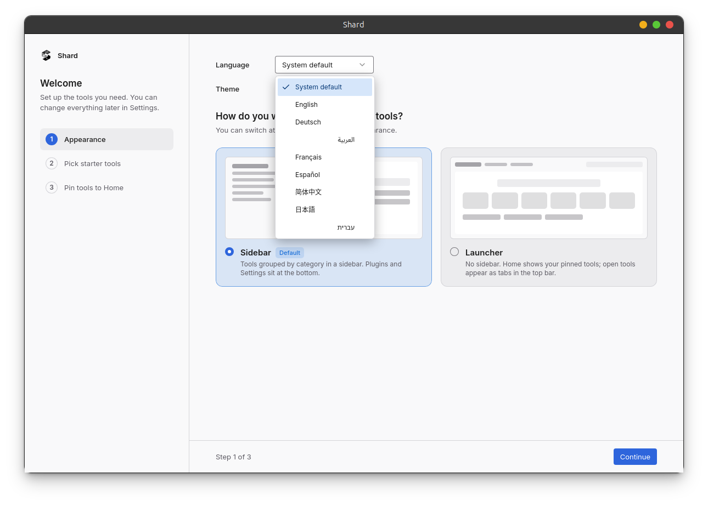
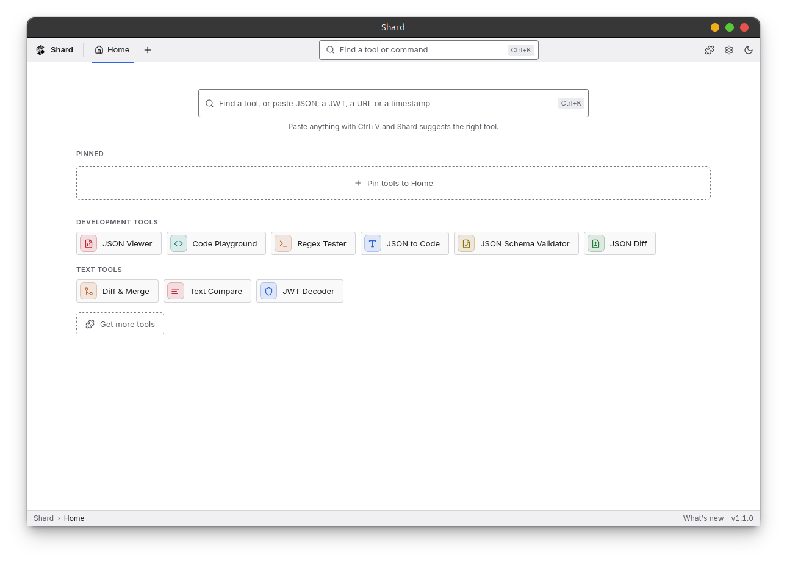

# Shard

**An offline desktop workspace for developers.** Nine built-in tools for JSON, text and diffs, plus a sandboxed plugin system for everything else. Runs on macOS, Windows, and Linux. Your data never leaves your computer.

<!-- TODO: add screenshot: assets/screenshots/hero.png (about 1600x900) - main window with JSON Viewer and two open tabs, light mode -->


[Download](#download) · [Features](#features) · [Plugins](#plugins) · [Tools](#tools) · [Development](#development) · [License](#license-and-credits)

> **Fork notice.** Shard is a fork of [DevTools](https://github.com/me-shaon/devtools) by [Ahmed Shamim](https://github.com/me-shaon), used under the MIT License. It is a separate project and is not affiliated with or endorsed by the original author. See [License and credits](#license-and-credits).

## What is Shard?

Shard keeps the everyday developer utilities you reach for (format JSON, decode a JWT, compare two files, test a regex) in one fast desktop app. Everything runs locally. There is no account, no analytics, and no telemetry. Update checks and plugin downloads are the only network use.

Shard builds on DevTools and changes the shape of the app:

| | DevTools | Shard |
|---|---|---|
| Tools | A large set of built-in tools | A core of 9 built-in tools; the rest are plugins |
| Extensibility | None | Plugins with a manifest, permissions, and a sandbox |
| Plugin sources | n/a | Repositories, zip files, folders, and GitHub URLs, with SHA-256 checks |
| Diff | Text Compare | Text Compare, plus Diff & Merge with folder compare |
| Onboarding | n/a | First-run setup with Sidebar or Launcher layout |
| Integration | n/a | `shard://` links for Raycast, Alfred, and scripts |

## Screenshots

<!-- TODO: add each screenshot below. Filenames and sizes are listed in assets/screenshots/README.md -->

| | |
|---|---|
|  |  |
|  |  |
|  |  |
|  |  |

## Features

- **Private by design.** Tools work offline. No account, no API key, no analytics, no telemetry.
- **Tabs, search, and pins.** Keep tools open with their inputs, search with the command palette, and pin up to 12 tools to Home.
- **Paste to find a tool.** Paste a JWT, JSON, URL, UUID, timestamp, cron expression, certificate, or cURL command and Shard suggests the right tool.
- **Native desktop feel.** Menu bar or tray icon, a global shortcut, `shard://` deep links, light and dark themes.
- **Plugins you control.** Every plugin lists its permissions before install and runs in a sandbox.
- **Automatic updates.** Optional, with an option to install on your schedule.

## Download

Get the latest release for your platform:

- **[macOS (Intel)](https://github.com/kinan9011/shard/releases/latest/download/Shard-macos-x64.dmg)**
- **[macOS (Apple Silicon)](https://github.com/kinan9011/shard/releases/latest/download/Shard-macos-arm64.dmg)**
- **[Windows](https://github.com/kinan9011/shard/releases/latest/download/Shard-windows-setup.exe)**
- **[Linux — .deb (Debian, Ubuntu, Mint) (x64)](https://github.com/kinan9011/shard/releases/latest/download/Shard-linux-amd64.deb)**
- **[Linux — .deb (Debian, Ubuntu, Mint) (arm64)](https://github.com/kinan9011/shard/releases/latest/download/Shard-linux-arm64.deb)**
- **[Linux — .rpm (Fedora, RHEL, openSUSE) (x64)](https://github.com/kinan9011/shard/releases/latest/download/Shard-linux-x86_64.rpm)**
- **[Linux — .rpm (Fedora, RHEL, openSUSE) (arm64)](https://github.com/kinan9011/shard/releases/latest/download/Shard-linux-aarch64.rpm)**
- **[Linux — .AppImage (x64)](https://github.com/kinan9011/shard/releases/latest/download/Shard-linux-x86_64.AppImage)**
- **[Linux — .AppImage (arm64)](https://github.com/kinan9011/shard/releases/latest/download/Shard-linux-arm64.AppImage)**

### Automatic updates

Shard checks for updates on startup and every six hours, downloads new versions in the background, and installs them when you quit. Use **Restart now** to install a downloaded update immediately, or turn off **Update automatically** in the sidebar to manage updates yourself. Update checks and downloads require an internet connection.

## Plugins

Plugins are tools you install, each with a web interface and an optional WebAssembly backend. Open **Plugins** in the app.

- **Install from a repository, a zip file, a folder, or a GitHub URL.** Two repositories are added for you and can be turned off: [`kinan9011/shard-plugins`](https://github.com/kinan9011/shard-plugins) for plugins and [`kinan9011/shard-themes`](https://github.com/kinan9011/shard-themes) for color themes. You can add your own. Packages from a repository are checked against a SHA-256 checksum. A zip, folder, or URL outside your repositories is unverified and needs the setting **Allow installs from zip files, folders and URLs outside these repositories**.
- **You approve what a plugin can do.** A plugin lists its permissions (clipboard, files, network access to named hosts) before it installs. Optional permissions can be left off, and you can change them later.
- **Plugins run in a sandbox.** A plugin's page runs in a sandboxed frame with no access to the app, and reaches the clipboard, files, and network only through the host, which checks every call against your approvals. A plugin that stops responding shows **Reload** and **Disable** and does not affect the rest of the app. See [plugin security](docs/plugins/security.md) for the model, the checks, and the known limits.
- **First run.** A new install opens a short setup: pick a layout (Sidebar or Launcher), install starter plugins, and pin tools to Home.
- **Write your own.** Start from the template in [`packages/plugin-sdk/`](packages/plugin-sdk/README.md). The docs cover the [manifest](docs/plugins/manifest.md), [permissions](docs/plugins/permissions.md), and the [repository index](docs/plugins/index-format.md). `plugins/examples/hello` is the smallest working plugin.

## Workspace and shortcuts

- **Keep tools open in tabs.** Switch between tools without losing their current inputs. Close a tab when you are finished.
- **Search by name or keyword.** Open the command palette with Cmd+K on macOS or Ctrl+K on Windows and Linux. Search for terms such as `sha`, `yml`, or `diff`.
- **Pinned tools and recents.** Pin up to 12 tools to Home, reorder them, and return to recently used tools. Cmd/Ctrl+1 through 5 opens your first five pinned tools. Customize these bindings in **Shortcuts**.
- **Light and dark appearance.** Shard follows the system theme initially; use the appearance button to switch between light and dark.
- **Paste to find a tool.** Paste text outside a text field, and Shard suggests the tool that fits: a JWT, JSON, a URL, a UUID, a timestamp, a cron expression, a certificate, a cURL command, and more. Press Enter to open the tool with the text filled in. Shard only reads what you paste. It never reads the clipboard on its own.
- **Menu bar and tray.** The Shard icon in the macOS menu bar, or the Windows and Linux tray, opens the app or its tool search.
- **Global shortcut.** Press Ctrl+Shift+Space in any app to open Shard with its tool search. Press it again to hide Shard. Change or turn off the shortcut in Shortcuts.

### Open a tool from other apps

Shard registers the `shard://` link scheme, so Raycast, Alfred, Shortcuts, a terminal, or a browser can open a tool directly. A link reuses the running window.

| Link | Result |
|---|---|
| `shard://open/<tool-id>` | Opens a tool, for example `shard://open/json-viewer`. The tool IDs are in [the tool registry](src/app/toolRegistry.ts). |
| `shard://search?q=<text>` | Opens the command palette with the text. |
| `shard://home` | Shows the home page. |

From a terminal on macOS, run `open "shard://open/hash-generator"`. On Linux, run `xdg-open` with the same link. On Windows, run `start` with the link.

## Tools

Shard has 9 built-in tools. They are always there: you can hide them, but not uninstall them. Every other tool is an official plugin.

### Built-in tools

#### Development Tools

- **JSON Viewer** - Format, minify, sort, and query JSON live, convert it to YAML or XML, and repair JSON5, NDJSON, and Python, Ruby, or JavaScript literals
- **Code Playground** - Experiment with JavaScript, HTML, and CSS
- **Regex Tester** - Test a pattern as you type, with highlighted matches, capture groups, and live replace
- **JSON to Code** - Generate TypeScript, Go, Rust, Python, Swift, and Kotlin types, or a JSON Schema, from JSON
- **JSON Schema Validator** - Check JSON or YAML against a JSON Schema as you type, and click each error to find the failing value
- **JSON Diff** - Compare two JSON or YAML documents by value, list changes by path, match array items by key, and copy the changes as a JSON Patch

#### Text Tools

- **Text Compare** - Aligned line, word and character diff with change navigation that can ignore whitespace and case
- **Diff & Merge** - JetBrains-style side-by-side diff with one-click merge arrows, word highlights, unified view and folder compare (desktop)
- **JWT Decoder** - Decode JWTs with expiry status, verify HS, RS, PS, ES, and EdDSA signatures with a secret, PEM, JWK, or JWKS, and sign test tokens

### Official plugins

About 45 more tools are available from Plugins in the app. Their sources are in [`kinan9011/shard-plugins`](https://github.com/kinan9011/shard-plugins).

<details>
<summary>Show the plugin catalog</summary>

**AI Tools**

- **AI Text Cleaner** - Remove hidden characters, citation markers, and Markdown from AI-written text, and straighten quotes and dashes.
- **Image Metadata Cleaner** - Remove AI prompts, Content Credentials (C2PA), AI-generated labels, GPS, and camera data from JPEG, PNG, and WebP images. Keep the original pixels, or save a clean copy as JPG, PNG, WebP, or AVIF.
- **Secret & PII Redactor** - Mask API keys, tokens, passwords, emails, and other personal data before you paste text into an AI chat, and restore the values in the reply.
- **Token Counter** - Count GPT tokens exactly, estimate Claude, Gemini, and Llama tokens, check the context window, and estimate cost from your own price table.
- **Video Metadata Cleaner** - Remove AI labels (C2PA, XMP), GPS, device data, dates, and telemetry tracks from MP4, MOV, MKV, and WebM videos without re-encoding. The audio and video data do not change.

**Converters**

- **Base64** - Encode and decode Base64 and Base32 text, files, and data URIs, with a URL-safe mode.
- **Case Converter** - Convert names to camelCase, snake_case, kebab-case, and 8 more cases live, one name per line, and make URL slugs.
- **Compression** - Decompress GZIP, zlib, and raw deflate from Base64, hex, or a .gz file, and compress text back, with format detection.
- **CSV to JSON** - Bidirectional CSV and JSON conversion with custom delimiters and nested key flattening.
- **cURL to Code** - Convert a cURL command to fetch, Node, Python, Go, PHP, Rust, or HTTPie code.
- **Escape Tools** - Escape and unescape HTML entities, backslash strings, Unicode, and hex, and convert domain names to and from Punycode.
- **HTML to JSX** - Convert HTML markup into React JSX.
- **Markdown** - Write Markdown and see a live, sanitized HTML preview.
- **Number Base** - See a number in binary, octal, decimal, hex, any base to 36, and Roman numerals as you type, with two's complement views, integer expressions, and a clickable bit grid.
- **PHP Tools** - Convert serialize() data, session data, and PHP arrays to JSON and back, and repair broken string lengths.
- **SVG to CSS** - Turn an SVG into a small data URI and ready CSS for backgrounds and masks.
- **URL Encoder** - Encode and decode URLs, and parse a URL into editable parts and query parameters.
- **Config Converter** - Convert between JSON, YAML, TOML, .env, Java .properties, and TOON files, including multi-document YAML, and see how many LLM tokens TOON saves against JSON.

**Development Tools**

- **ASN.1 Inspector** - Show definite-length DER or BER data from PEM, Base64, hex, or a file as a tree of tags, offsets, lengths, and values.
- **X.509 Certificate Decoder** - Read PEM and DER certificates and CSRs, check validity and fingerprints, and verify a chain offline.
- **Code Formatter** - Beautify or minify HTML, CSS, JavaScript, XML, and SQL.
- **HTML Preview** - Render HTML in a sandbox that cannot reach the network or the app.
- **Mermaid Renderer** - Render Mermaid flowcharts and sequence, class, ER, state, Gantt, and other diagrams as you type, and save them as SVG or PNG.
- **Semver Calculator** - Check versions against npm, Cargo, Composer, or Python ranges, see the range as plain comparators, and compare two versions.
- **XML Inspector** - Format or minify XML, and query nodes or values with XPath 1.0 and namespace prefixes.

**Generators**

- **Bcrypt Generator** - Generate bcrypt hashes locally.
- **Hash Generator** - MD5, SHA-1, SHA-2, SHA-3 and Keccak-256 hashes, HMAC and file hashing.
- **Key Pair Generator** - Generate RSA, ECDSA, and Ed25519 key pairs as PEM, JWK, and OpenSSH keys with fingerprints, or convert a key you paste.
- **Lorem Ipsum** - Generate placeholder text and fake names, emails, URLs, and titles as text or a JSON array.
- **Password Generator** - Generate secure passwords and passphrases with strength analysis.
- **QR Generator** - Make QR codes for text, Wi-Fi, contacts, email, phone, SMS, locations and events, with an optional logo, and save them as PNG or SVG.
- **Random String** - Generate Nano IDs, hex and Base64URL tokens, and strings from a custom alphabet.
- **UUID Generator** - Generate v1/v3/v4/v5/v6/v7 UUIDs and ULIDs, and inspect existing IDs.

**Media**

- **Color Palette** - Convert CSS colors, build palettes and gradients, check WCAG contrast and color blindness.
- **Image Converter** - Convert and compress single images or batches locally to JPEG (MozJPEG), PNG (OxiPNG), WebP, or AVIF. Resize with Lanczos3 and other filters, and reduce the color palette. Crop, rotate, and flip an image in the Edit Image tab.
- **QR Reader** - Read a QR code from an image file, a dropped image, or a pasted screenshot.

**Network**

- **HAR Viewer** - Filter, sort, and inspect the requests in a .har file from the browser, copy a request as cURL, and save a sanitized copy without credentials and cookies.
- **IP / CIDR Calculator** - Get the network, broadcast, host range, masks, and address type for IPv4 and IPv6 blocks, and split, merge, or check ranges.

**Text Tools**

- **API Formatter** - Format or minify JSON API responses, and turn URL-encoded data and query strings into JSON.
- **Line Tools** - Filter, sort, reverse, dedupe, trim, and shuffle lines, and compare two lists. Split, join, wrap, replace, sum, or multiply lines in Transform mode.
- **String Inspector** - Count characters, words, lines, and bytes, find hidden Unicode characters, and check Unicode normalization (NFC, NFD, NFKC, NFKD).

**Time & Date**

- **Cron Calculator** - Explain any cron expression in plain English, with a field breakdown and the next runs.
- **Date Difference** - Calculate the difference between two dates.
- **Date Format Translator** - Translate date format strings between Go, strftime, Java, date-fns, Moment.js, PHP, and .NET, with a live preview.
- **Stopwatch** - Record laps and split times, and copy or export them as CSV. The stopwatch keeps running while you use other tools.
- **Time Zone Converter** - Convert a date and time from one time zone to UTC, local time, and other zones. It handles daylight saving time changes and shows when the date changes.
- **Timestamp** - Convert Unix timestamps (seconds to nanoseconds) and date strings as you type, with offsets such as now - 1d and extra time zones.

**Utilities**

- **Checksum** - Calculate six common CRC variants from text, hex bytes, or a file, and validate or append Luhn check digits.
- **chmod Calculator** - Set file permissions with checkboxes, octal, or rwx text, apply expressions such as u+x, and see the chmod commands, a plain-English summary, and umask defaults.
- **Unit Converter** - Convert length, weight, temperature, and data units.

</details>

## Development

### Prerequisites

- Node.js 22+ and npm.
- Stable Rust, installed with [rustup](https://rustup.rs).
- The [Tauri system prerequisites](https://v2.tauri.app/start/prerequisites/) for your platform.

On Debian or Ubuntu, install the native build dependencies:

```bash
sudo apt-get install -y libwebkit2gtk-4.1-dev libayatana-appindicator3-dev librsvg2-dev \
  libxdo-dev libssl-dev patchelf file rpm
```

### Run locally

```bash
git clone https://github.com/kinan9011/shard.git
cd shard
npm ci
npm run dev
```

For UI-only development, run `npm run dev:web` and open the URL printed by Vite. Browser preview does not provide native desktop integrations or the updater.

### Commands

| Command | Purpose |
|---|---|
| `npm run dev` | Start Vite and the Tauri desktop app with hot reload |
| `npm run dev:web` | Run the web UI in a browser |
| `npm run build:web` | Build the frontend into `dist/` |
| `npm run build` | Build the desktop app and installers for the current platform |
| `npm test` | Run the Vitest suite |
| `npm run test:watch` | Run tests in watch mode |
| `npm run lint` | Run ESLint |
| `npm run dist:mac` | Build macOS `.app` and `.dmg` packages |
| `npm run dist:win` | Build the Windows NSIS installer |
| `npm run dist:linux` | Build Linux AppImage, Debian, and RPM packages |
| `npm run brand:build` | Rebuild logos, favicons, and desktop icons |

Installers are written to `src-tauri/target/release/bundle/`. Each platform builds its own installers; CI builds the supported platforms. See the [release process](docs/release-process.md) for versioning, signing, and publishing.

### Desktop smoke test

The [smoke test](e2e/smoke.mjs) launches the built app through `tauri-driver` and checks the main flows on Linux: it skips the first-run setup, opens the tools, installs the hello plugin from a folder, opens it, and uninstalls it. In addition to the build dependencies, install `xvfb` and `webkit2gtk-driver`:

```bash
sudo apt-get install -y xvfb webkit2gtk-driver
cargo install tauri-driver --locked
npm run build
xvfb-run node e2e/smoke.mjs
```

### Project structure

```text
src/
├── app/
│   ├── Shard.tsx          # Workspace, tabs, navigation, and app settings
│   └── toolRegistry.ts    # Tool names, categories, keywords, and lazy imports
├── components/
│   ├── app/               # Command palette, paste suggestions, and shortcuts
│   └── tools/             # Tool interfaces and shared workspace components
├── lib/desktop.ts         # Bridge to native desktop capabilities
├── utils/                 # Conversion, parsing, generation, and validation logic
└── main.tsx               # React entry point
src-tauri/                 # Rust backend, native integration, and bundle config
tests/                     # Unit and component tests
e2e/                       # Desktop smoke tests
scripts/                   # Release and brand asset tooling
```

Built with Tauri 2, React 18, TypeScript, Vite, Tailwind CSS, and shadcn/ui. Tauri uses the system webview with a Rust backend.

### Add a tool

New tools should be plugins, not built-in tools. The 9 built-in tools are the core of the app and the registry in [toolRegistry.ts](src/app/toolRegistry.ts) stays at that size.

1. Start from the plugin SDK in [`packages/plugin-sdk`](packages/plugin-sdk) (it has a template).
2. Put the plugin in the official repository, [`kinan9011/shard-plugins`](https://github.com/kinan9011/shard-plugins). Its README explains the layout, the build and test commands, and how to add a row to its plugin table.
3. Add tests for non-trivial behavior and run `npm run build` and `npm test` in the plugin folder.

## Contributing

Pull requests are welcome. For major changes, open an issue first to discuss the proposal. Include a description of the change and the checks you ran; include current screenshots for UI changes.

## Support

Shard is free and open source. Found a bug or have an idea? [Open an issue](https://github.com/kinan9011/shard/issues).

## License and credits

Shard is released under the [MIT License](LICENSE).

- Copyright (c) Ahmed Shamim, the author of the original [DevTools](https://github.com/me-shaon/devtools).
- Copyright (c) 2026 kinan9011, for the changes made in Shard.

The MIT License requires that the original copyright and permission notice stay with every copy or substantial portion of the software. The [LICENSE](LICENSE) file keeps both notices; do not remove them when you fork or redistribute Shard.

The logo, icons, and favicon are inherited from DevTools and are being replaced with a Shard identity. See the [brand asset guide](assets/brand/README.md). Third-party libraries keep their own licenses; see each package's license in `package.json`, `Cargo.toml`, and the plugin repositories.
